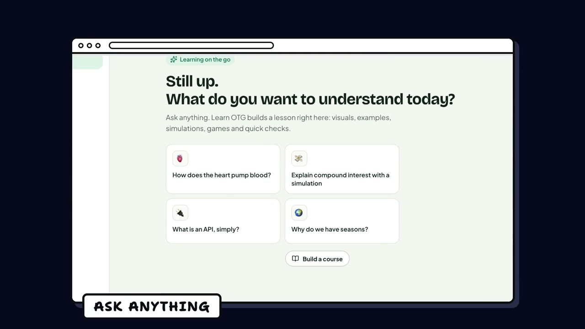
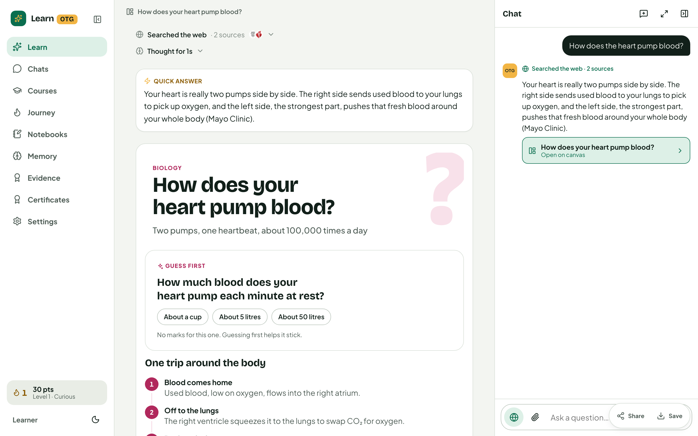
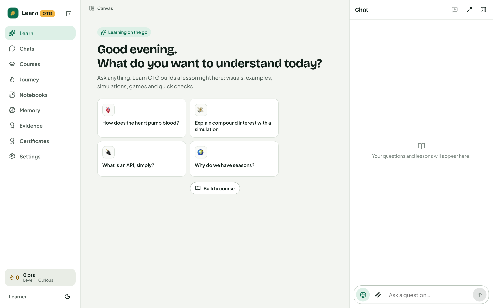
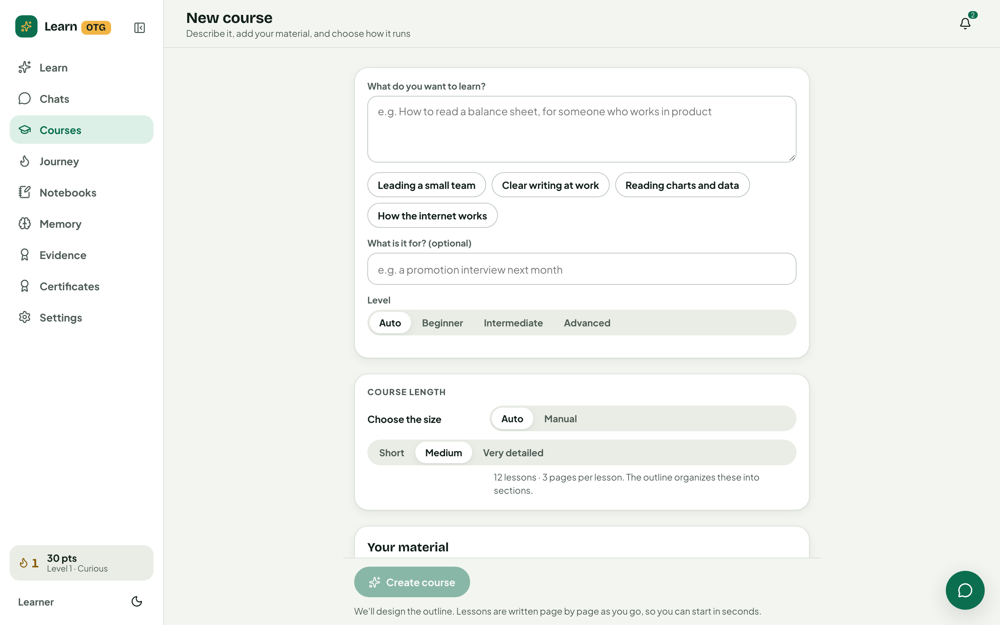
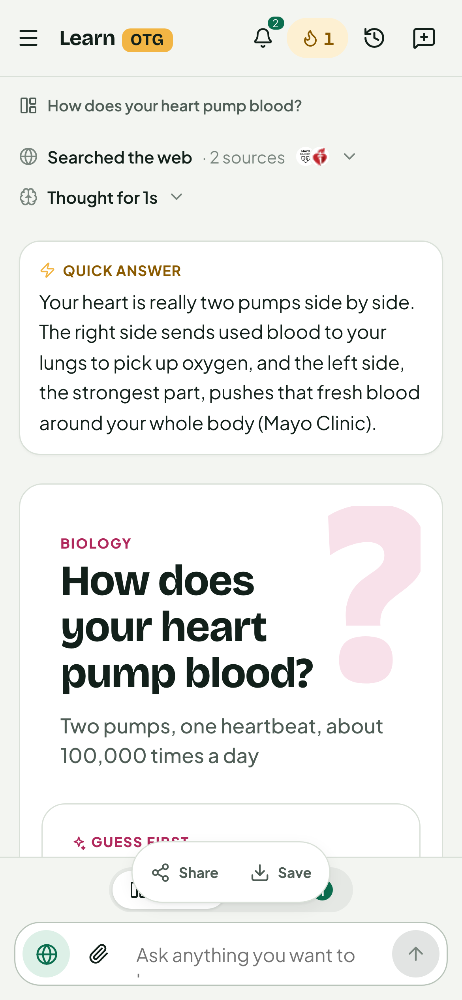

# Learn OTG: learning on the go

Learn anything without waiting for someone to make a course. Ask a question and Learn OTG builds a visual lesson right there: steps, charts, tabs, a quick quiz. Or give it a topic, your own files, websites or YouTube videos, and it builds a whole course for you, page by page, as you go.

[](https://kunlemaxwell.com/works/learn-otg#film)

**[Watch the launch film](https://kunlemaxwell.com/works/learn-otg#film)** (under a minute), or [download it](docs/learn-otg-launch.mp4). New here? Read the [step-by-step user guide](https://be-guided.pages.dev/learn-otg/).



## Why I built it

I have wanted this for a long time: a learning platform where anyone can create a course on the fly for whatever they want to learn, without a ready-made course. What finally started it was the generative UI release from OpenUI. Seeing an AI build real interface pieces, not just text, sparked the idea of lessons that are drawn for you as you ask.

Courses still matter. But you can now learn a lot with your AI without taking a full course, and most of that learning is never seen or checked by anyone. Learn OTG lets you show and share what you learned, and earn a certificate for it, so the learning becomes visible and counts.

## What it does

- **Lessons on a canvas.** Ask anything and get a visual lesson instead of a wall of text: a big idea, steps, timelines, comparisons, charts, tabs and key terms. A quick answer shows in a second or two while the full lesson builds.
- **Courses on the fly.** Pick a topic and a size (short, medium, very detailed, or your own number of lessons and pages). Lessons are written page by page as you reach them, so you start in seconds.
- **Your own material.** Build a course from files (PDF, Word, slides, spreadsheets), websites or YouTube captions, and choose "only my sources" or "my sources plus general knowledge".
- **Quizzes and practice.** Guess-first questions, quizzes after lessons and sections, a final quiz, and typed answers that get marked with feedback.
- **A tutor for every lesson.** Ask about the page you are reading, attach a document or photo, ask for a diagram.
- **Notebooks.** Select any text to ask about it or save it to a notebook.
- **Memory and journey.** It remembers your weak spots and brings them back. Points, levels and a journey keep you going.
- **Show your work.** Completion evidence for a lesson, a course or several courses together: what you learned, skills, scenarios and real counts from your progress. Share it as a link, image or PDF.
- **Certificates.** Earned from recorded progress, not made up by the AI.
- **Works on your phone.** Built mobile first.

| Home | New course | On a phone |
|---|---|---|
|  |  |  |

## Run it

You need [Node.js](https://nodejs.org) 20 or newer (the LTS version is fine) and [Git](https://git-scm.com). Then:

```bash
git clone https://github.com/kunlemaxwell/learn-otg.git
cd learn-otg
node scripts/setup.mjs
```

The setup walks you through everything:

1. Checks your Node.js version and tells you what to install if it is too old.
2. Installs the packages (`npm install`).
3. Helps you add free API keys, step by step, or skip them and use demo mode.
4. Writes your `.env.local` and starts the app at http://localhost:3000.

Run it again any time to add or change keys (`npm run setup` works too once packages are installed). On a Mac you can also double-click `Start Learn OTG.command`: it runs the setup the first time, then just starts the app.

### Free API keys (optional, about 2 minutes each)

With no keys the app runs in **demo mode**: sample lessons and courses, no AI calls. For real lessons add one or both:

**Groq** (fastest)
1. Go to [console.groq.com](https://console.groq.com) and sign in (Google or GitHub works).
2. Open [API Keys](https://console.groq.com/keys) and click **Create API Key**.
3. Copy the key (starts with `gsk_`) and paste it when the setup asks.
4. In the app, open **Settings** and pick a Groq model (Qwen) as your default if you only have this key.

**NVIDIA** (strongest free models: GLM, Kimi)
1. Go to [build.nvidia.com](https://build.nvidia.com) and sign in or create a free account.
2. Open a model page (search for GLM or Kimi) and click **Get API Key**, then **Generate Key**.
3. Copy the key (starts with `nvapi-`) and paste it when the setup asks.
4. If a model later returns 403, open that model's page and click **Try API** once.

Optional: a [Tavily](https://tavily.com) key gives better web search. Without it the app uses DuckDuckGo and Wikipedia.

Keys stay on your computer, in `.env.local`, and are only used by the server. Never commit or share that file. You can also set things up by hand: copy `.env.example` to `.env.local`, fill it in, then `npm install` and `npm run dev`.

Demo mode on purpose: set `LEARN_OTG_MOCK=1`, or open any page with `?mock=1`. To try it on your phone (same Wi-Fi): `npm run dev:phone`, then open your computer's IP address and port 3000.

### Built with

- [OpenUI](https://github.com/thesysdev/openui) by Thesys: the generative UI language and React renderer that draws each lesson.
- [Next.js](https://nextjs.org), [React](https://react.dev), [Radix UI](https://www.radix-ui.com) and [Lucide](https://lucide.dev) icons.
- Free models from [NVIDIA](https://build.nvidia.com) and [Groq](https://console.groq.com).

## Honest limits

- **Built to prove the idea.** This is a working prototype I put out there, not a finished product.
- **Smaller, faster models.** It uses free NVIDIA-hosted and Groq models for speed. The quality of a lesson depends on the model, and these models can be wrong.
- **Not grounded in a validated knowledge base.** Lessons come from the model's own knowledge plus quick web searches. Do not trust it blindly; check anything important.
- **If you build on it**, make it fetch from a validated knowledge base instead of relying on the model's raw knowledge. That is the most important next step.
- **Your data stays in your browser.** There is no login or database. Shareable evidence links need the app running at a public address.
- **Free tiers are for trying, not production.** NVIDIA and Groq free limits are low.

## How it works (fast path)

0. **Instant answer**: while the lesson builds, Qwen 3.8 27B on Groq streams a 2–3 sentence answer within a second or two, grounded with the same search results. Toggle in Settings → Features.

1. **Router** decides if the question needs fresh facts (news, prices, roles, "latest", years). Fast models (Qwen, GPT-OSS) and Kimi always get sources for new questions.
2. **Research in parallel**: 1–2 searches and the top 2–3 pages run at the same time and become one compact source digest. Search and page results are cached for 3 hours.
3. **One model call** with a lean system prompt (~3.4k tokens: a learning-focused subset of OpenUI plus Learn OTG's own components) and low reasoning effort by default.
4. **Learn OTG components** — `LessonHeader`, `BigIdea`, `Flow`, `StatGrid`, `Compare`, `Timeline`, `KeyTerms`, `Takeaways`, `Quiz` — shadcn-style cards built on Radix, so every lesson is visual and the model writes one line instead of a whole card tree. The Quiz grades instantly in the browser with a hint on the first wrong try, no model call.
5. **Lesson cache**: the first question of a chat is cached per model (7 days, or 6 hours if it used web sources), so repeats are instant.
6. **Speed stats** under each lesson: total time, time to first words, research time, tokens in/out, tokens per second, components reused.

## Memory

- The latest lesson goes to the model in full; earlier lessons become ~100-token recaps (title, big idea, what was covered, quiz and answer).
- Very old turns collapse into a list of earlier questions. Nothing is lost: the model can call `recall_lesson` to fetch any earlier lesson in full.
- A **learner record** (recent quiz results, kept on the device) is sent with each question so the tutor revisits weak spots.
- On Groq (8K tokens/minute) the app keeps context and sources smaller automatically.

## Component memory

After each lesson, reusable sections (a Tabs comparison, a chart card, a step flow) are saved automatically and offered back to the model as proven layouts for related questions. Manage them in Settings → Component memory: **Auto-save** (default), **Reuse only**, or **Reinvent** (build from scratch). Saved components and caches live in `.learn-otg-data/`.

## Web browsing

The model can call two tools before it builds a lesson:

- `web_search(query)`: uses Tavily or Brave if you add a key, otherwise DuckDuckGo (no key), with Wikipedia as a fallback.
- `open_url(url)`: reads a page's text. Private and local network addresses are blocked, including through redirects.

The server runs the tool loop (up to 4 rounds, then the model must answer). You see each step live on the canvas ("Searching…", "Reading…"), and the sources used appear as links under the lesson. Turn browsing off in Model settings → Features. Each tool round is one extra NVIDIA request, so browsing uses the free rate limit faster.

## Chat history

Every conversation is saved in this browser (localStorage), including its lessons. Open the history drawer (clock icon, top left) to reopen or delete chats, or start a new one (top right). The welcome screen also shows your three most recent chats. History stays on the device. Large attached photos aren't kept, to save space.

## Models

Tap the model chip (top right) to pick a model. Each shows only the parameters its provider documents.

| Model | Provider | Best for | Note |
|---|---|---|---|
| **GLM-5.3** (default) | NVIDIA | Accurate lessons, tool use | Most reliable free model (~30% guess rate when unsure) |
| **Qwen 3.8 27B** | Groq | Fast lessons, images | ~10× faster; always grounded with sources; preview model |
| **Kimi K3** | NVIDIA | Photos, homework | Slower; guesses more, so always grounded |
| **GPT-OSS 120B** | Groq | Quick tests only | Fastest, least reliable |

GLM-5.3 defaults to **thinking off**, which sends NVIDIA its supported `reasoning_effort: "low"`; it never sends thinking-disable template flags. Other models default to low. Raise it in settings for hard maths. Research and thinking show as folded rows ("Searched the web · 5 sources", "Thought for 8s") you can tap to expand.

Settings are saved in the browser. "NVIDIA defaults" and "App defaults" reset them.

## Notes

- Free tiers: NVIDIA about 40 requests a minute; Groq about 30 requests, 1,000 a day and 8,000 tokens a minute. Both are for prototyping, not production.
- Model definitions live in `src/lib/models.ts`. Add another NVIDIA model by adding an entry with its ID and documented parameters.

## Interactive lessons and materials

Course lessons have their own saved chat. Open **Ask about this lesson**, type a question, attach documents or an image, or ask for a slide or diagram. The tutor receives the page you are reading and your saved answers. Minimize the chat to keep reading; it follows the page as you scroll. The final page includes a typed question if the generated lesson has none.

Select or copy lesson text to open **Ask Learn OTG** and **Save to notebook**. Right-click still opens the browser's normal menu. Save directly to General, choose a named notebook, or create one while saving. Open Notebooks to search, edit and organize saved passages.

A compact bottom toolbar keeps **Share**, **Save**, and **Ask OTG** available. Share and Save open small menus. Choose this page, this lesson so far, or the entire course so far. Multiple images download together as a ZIP; PDFs combine completed pages and generated quizzes. Exporting does not write unfinished pages.

The top-right bell keeps points, completion and in-app continuation reminders. Memory shows three items first; **View all** opens search and a longer list.

When creating a course, add any mixture of files, websites and YouTube videos. YouTube uses spoken captions, rather than visual video analysis. If a video has no available captions or access is limited, paste its transcript. Long caption transcripts currently use the first 60,000 characters, clearly labeled in the source list. Sites must have public readable text.

Chats, notebooks and notifications remain on this browser and device. The existing NVIDIA and Groq keys power the tutor; no extra Gemini key is required for captions.

## Completion evidence

Completed lessons have a **Generate completion evidence** action. Completed courses also have one on their course page. In **Evidence**, select one or more completed courses to combine their learning into a single profile. The saved library separates courses from lessons and shows six records before **View more**.

Choose **Settings → Lessons & chat → Completion evidence** to generate when you ask (default) or automatically after completion. AI writes practical skills, key lessons and scenarios from the actual lesson material. Completion counts and certificate codes come from saved progress, not from AI. Quiz counts include recorded in-lesson multiple-choice checks and separate course quizzes; scenarios count only recorded answers. An interrupted or failed summary can be retried. Generation is queued to avoid simultaneous model calls in one tab.

The evidence profile includes the learner, completion date, learning summary, activity counts and earned certificates at the bottom. **Share evidence** offers a copy link, LinkedIn, WhatsApp, X, Teams, email and Gmail, plus image/PDF downloads. The normal share dialog is used where supported; otherwise image sharing downloads an image. Sharing never happens automatically.

Links carry a compressed snapshot in the URL fragment, so the recipient does not need the learner's browser data. The snapshot contains the displayed completion profile, without raw answers, chats or uploaded documents. There is no hosted evidence database. A localhost address works only on the owner's computer; shareable internet links require deploying the app to a public address. Link previews show the app's general information because the snapshot is read in the recipient's browser. Downloaded images/PDFs can be shared immediately.

Chat attachments use the existing document extractor (PDF, DOCX, PPTX, XLSX, CSV and text formats), or the image reader. Up to four files, including one image, can be attached; 15 MB per file. Unsupported files and unreadable documents show an error, and Send waits while files are being read. Extracted document text is bounded for model context.

Focused evidence regression checks: `npm run test:evidence`.


## Course size and source policy

New courses default to **Auto → Medium**: 12 lessons with three pages each. Short gives six lessons with two pages each; Very detailed gives 24 lessons with five pages each. **Manual** accepts an exact 1–40 lessons and 1–8 pages per lesson. **One-page article** selects one lesson and one page. The planner must provide enough lessons; surplus lessons are trimmed. Short page plans are filled with focused explanation/practice pages so the saved course matches the requested count. These controls are also available in Settings → Course defaults. Existing courses retain their saved pages.

In the course creator, **Reference knowledge** lets you choose up to six existing courses. Their source summary, lesson summaries and written material become reference sources; private answers and chats do not. With sources or references selected, choose **Only my sources and course references** or **My sources plus general knowledge**. The source-only policy disables lesson web research and outside-memory context, and applies to planning, lesson pages, quizzes and the lesson tutor. It is an instruction to the AI, not a guarantee of factual correctness; inspect important claims in the source.

## Model recovery

The immediate answer is separate from the full lesson. The full provider request now has a 45-second silence timeout and a three-minute total cap. Empty output, streamed provider errors, truncated answers and incomplete client streams produce an explicit failure. With **Try a backup model** enabled, a stalled/empty full lesson that has not started writing is attempted once on the configured backup. A recently stalled model is bypassed for three minutes with a visible notice; the chosen model in Settings remains unchanged. Fallback lessons use a compact valid component specification retaining all component signatures to fit Groq's free-tier budget. Course planning also falls back when the selected provider stalls. Completed pages and the immediate answer are retained.

Focused recovery and course checks: `npm run test:course`.

## Tests

`npm run test:evidence` and `npm run test:course` run focused checks. `npm run lint` and `npm run build` should pass.

## Licence

MIT. See [LICENSE](LICENSE).
